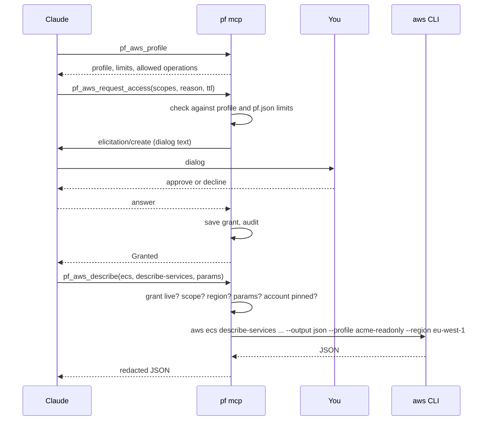

# AWS access for the agent

The agent can read AWS state to troubleshoot, within a **grant** you approve. A grant is read-only, limited to scopes and regions, and short-lived. The agent never gets credentials: pf passes only `--profile <name>` to the aws CLI and checks every call itself.

## The flow



## What the agent sees

`pf_aws_profile` (abridged):

```text
pf profile: acme (from pf.json)
AWS profile: acme-readonly
account: 123456789012 (pinned)
region: eu-west-1
limits: scopes identity, ec2, ecs, logs; regions eu-west-1; at most 60 min
grant: none. Call pf_aws_request_access with the scopes you need and why.

Operations by scope (pf_aws_describe accepts only these):
- identity (who the credentials are (always part of a grant)): sts: get-caller-identity
- ecs (clusters, services, tasks, task definitions (environment values redacted)): ecs: list-clusters, describe-clusters, ...
...
You never get credentials: pf runs each call itself and checks it against the grant. Secret-looking values are redacted.
```

A request (the arguments Claude sends):

```json
{ "scopes": ["ecs"], "reason": "api returns 502 after the last deploy", "ttlMinutes": 20 }
```

After you approve:

```text
Granted. active grant: scopes identity, ecs; regions eu-west-1; 20 min left; approved by the user in pf's dialog
Use pf_aws_whoami to confirm the account, then pf_aws_describe.
```

A read. Params are AWS CLI flags without the dashes: a list becomes several values, `true` a bare flag, and `false` is left out.

```json
{
  "service": "ecs",
  "operation": "describe-services",
  "params": { "cluster": "web", "services": ["api"], "query": "services[].{name:serviceName,running:runningCount,desired:desiredCount,events:events[:5]}" }
}
```

pf runs:

```bash
aws ecs describe-services --cluster web --services api --query '...' --output json --profile acme-readonly --region eu-west-1
```

## What gets refused

| Call | Answer |
|------|--------|
| `secretsmanager get-secret-value` | `aws secretsmanager get-secret-value is never allowed: it returns secret values.` |
| `logs filter-log-events` without the scope | `... needs the "logs" scope, which this grant does not include. Request it with pf_aws_request_access.` |
| `ec2 terminate-instances` | `... is not a read-only operation pf allows. Call pf_aws_profile for the list.` |
| `params: { "cluster": "file:///etc/passwd" }` | `--cluster: values that load a file or URL are not allowed` |
| `params: { "profile": "prod" }` | `--profile is set by pf or not allowed` |
| a region outside the grant | `Region us-east-1 is outside the grant (eu-west-1).` |
| `scopes: ["rds"]` beyond the profile | `The profile "acme" does not allow rds ...` (you are not asked) |
| any call before a grant | `No live AWS grant for profile "acme". Call pf_aws_request_access ...` |
| credentials resolve to another account | `This is not the pinned account 123456789012. pf refuses to read anything with these credentials; ...` |

## Scopes

| Scope | Services and operations |
|-------|-------------------------|
| `identity` | `sts get-caller-identity` (part of every grant) |
| `ec2` | `ec2 describe-instances`, `describe-instance-status`, `describe-security-groups`, `describe-security-group-rules`, `describe-subnets`, `describe-vpcs`, `describe-volumes`, `describe-snapshots`, `describe-images`, `describe-network-interfaces`, `describe-route-tables`, `describe-addresses`, `describe-availability-zones`, `describe-regions`, `describe-nat-gateways`, `describe-internet-gateways`, `describe-tags`, `describe-launch-templates`; `autoscaling describe-auto-scaling-groups`, `describe-scaling-activities`, `describe-auto-scaling-instances` |
| `ecs` | `list-clusters`, `describe-clusters`, `list-services`, `describe-services`, `list-tasks`, `describe-tasks`, `list-container-instances`, `describe-container-instances`, `list-task-definitions`, `describe-task-definition` (environment values redacted) |
| `rds` | `describe-db-instances`, `describe-db-clusters`, `describe-db-snapshots`, `describe-events`, `describe-pending-maintenance-actions`, `describe-db-subnet-groups`, `describe-db-log-files` |
| `elb` | `elbv2 describe-load-balancers`, `describe-listeners`, `describe-rules`, `describe-target-groups`, `describe-target-health`, `describe-load-balancer-attributes`, `describe-target-group-attributes`; `elb describe-load-balancers`, `describe-instance-health` |
| `cloudwatch` | `describe-alarms`, `describe-alarm-history`, `list-metrics`, `get-metric-statistics`, `get-metric-data` |
| `logs` | `describe-log-groups`, `describe-log-streams`, `describe-metric-filters`, `filter-log-events`, `get-log-events` (opt-in: log text can hold secrets) |
| `ssm-metadata` | `describe-instance-information`, `describe-instance-patch-states`, `describe-parameters` (names, never values), `list-commands` |
| `s3-metadata` | `s3api list-buckets`, `get-bucket-location`, `get-bucket-versioning`, `get-bucket-encryption`, `get-public-access-block`, `get-bucket-policy-status`, `get-bucket-lifecycle-configuration`, `list-objects-v2`, `head-object` (never object contents) |

Without `--scopes`, a profile allows every scope except `logs`, for at most 60 minutes per grant (`--max-ttl`, up to 480).

Never allowed, with any grant:

- secret values: `secretsmanager get-secret-value`, `ssm get-parameter(s)`, `get-parameters-by-path`
- command output: `ssm get-command-invocation`
- shells: `ssm start-session`
- file contents: `s3api get-object`, `s3 cp`, `s3 sync`
- decryption: `kms decrypt`
- code links: `lambda get-function`
- passwords and user data: `ec2 get-password-data`, `describe-instance-attribute`, `describe-launch-template-versions`, `autoscaling describe-launch-configurations`
- credentials: `ecr get-login-password`, `sts get-session-token`, `assume-role`, `get-federation-token`, `iam create-access-key`
- `rds download-db-log-file-portion`

Anything not listed in a scope is refused as well.

Flags pf sets itself or refuses: `--profile`, `--region`, `--output`, `--endpoint-url`, `--cli-input-json`, `--cli-input-yaml`, `--generate-cli-skeleton`, `--debug`, `--ca-bundle`, `--no-verify-ssl`, `--no-sign-request`, `--cli-binary-format`, `--with-decryption`, `--color`, `--no-paginate`, `--page-size`. Values may not load a file or URL (`file://`, `fileb://`, `http(s)://`) or start with `--`.

## Redaction

pf parses the JSON and hides:

- every `value` in a container `environment` list (ECS task definitions), keeping the names;
- any string field whose key looks secret (`password`, `secret`, `token`, `credential`, `privateKey`, `apiKey`, `UserData`), except `nextToken`, which paging needs;
- the `Value` of a name/value pair whose name looks secret (`{ "Name": "db_password", "Value": "..." }`).

Then pf masks secret-looking text anywhere, which matters most for logs: access key ids (`AKIA...`, `ASIA...`), private key blocks, JWTs, `Bearer` tokens, and `password=`, `secret:`, `token=`, `api_key=`, `aws_secret_access_key=` pairs. Output over 30,000 characters is cut, with a hint to narrow the call with `--query`, `--filters` or `--max-items`.

```json
{
 "containerDefinitions": [
  { "name": "api", "image": "acme/api:1.42", "environment": [
    { "name": "DB_HOST", "value": "[redacted by pf]" },
    { "name": "API_KEY", "value": "[redacted by pf]" } ] }
 ]
}
```

Redaction is a safety net, not a guarantee. Keep the `logs` scope off profiles whose logs carry secrets.

## Grants

A grant is stored in `~/.pf/agent/grants.json`. It holds names and limits only, never credentials. It belongs to one agent session (one `pf mcp` process), and ends at the first of:

- its time running out;
- the session ending (pf drops grants whose server process is gone);
- `pf aws revoke`. The server re-reads the file on every call, so a revoke applies to the next call.

```text
$ pf aws grants
┌──────────┬─────────┬───────────────┬───────────┬────────┬─────────────┬───────────────────────────────────────┐
│ session  │ profile │ scopes        │ regions   │ left   │ approved in │ reason                                │
├──────────┼─────────┼───────────────┼───────────┼────────┼─────────────┼───────────────────────────────────────┤
│ 6f1c9a2e │ acme    │ identity, ecs │ eu-west-1 │ 23 min │ pf dialog   │ api returns 502 after the last deploy │
└──────────┴─────────┴───────────────┴───────────┴────────┴─────────────┴───────────────────────────────────────┘
End one with pf aws revoke <session> or all with pf aws revoke --all

$ pf aws revoke 6f1c9a2e --dry-run
would revoke 6f1c9a2e (acme: identity, ecs)

$ pf aws revoke --profile acme
✓ revoked 1 grant; the agent's next AWS call is refused
```

## Audit log

Each agent session writes one log to `~/.pf/agent/audit/<time>-<session>.log` (owner-only): a header, then one JSON line per event. Tool arguments are logged, AWS responses are not.

```text
{"id":"053c1b29","startedAt":"2026-11-05T22:42:39.505Z","kind":"agent","cwd":"/Users/me/code/acme-api","user":"me","pf":"4.38.0"}
{"at":"...","event":"aws-request","profile":"acme","scopes":["identity","ecs"],"regions":["eu-west-1"],"ttlMinutes":20,"reason":"api returns 502 after the last deploy"}
{"at":"...","event":"aws-decision","profile":"acme","approved":true,"action":"accept"}
{"at":"...","event":"tool","tool":"pf_aws_request_access","args":{"scopes":["ecs"],"reason":"...","ttlMinutes":20},"ok":true}
{"at":"...","event":"aws-call","service":"ecs","operation":"describe-services","region":"eu-west-1","ok":true}
{"at":"...","event":"aws-refused","service":"secretsmanager","operation":"get-secret-value","reason":"..."}
```

Other events: `aws-account-mismatch` (expected and actual account), and `tool` for every tool call.

## When the agent CLI cannot show a dialog

| Situation | What happens |
|-----------|--------------|
| Claude Code, interactive (`pf agent`) | pf's dialog |
| Claude Code, `claude -p` (no UI) | Claude cancels the dialog, so nothing is granted |
| Claude Code without elicitation support | refused: the server runs with `--require-elicitation` because the tool is on Claude's allowlist |
| Codex or Cursor with elicitation | pf's dialog |
| Codex or Cursor without it | the CLI's own tool prompt counts as the approval (`approved in: agent prompt`) |

## Adding an operation or scope

This is for pf developers. Add one line to `SCOPES` in `packages/plugin-aws/src/access.ts`:

```ts
{
  name: 'ecs',
  summary: 'clusters, services, tasks, task definitions (environment values redacted)',
  ops: {
    ecs: [/* ... */, 'describe-capacity-providers'],     // a new read operation
  },
},
{
  name: 'lambda-metadata',                               // a new scope
  summary: 'functions and their configuration (never code)',
  ops: { lambda: ['list-functions', 'get-function-configuration'] },
},
```

Before adding one, check what it returns. If it can include secrets, file contents, user data or credentials, add it to `DENIED` with a reason instead. A new scope is off for profiles that list their scopes until the user adds it. Profiles without `scopes` get every scope except `logs`, so change `DEFAULT_SCOPES` when a new scope should be opt-in. Add a case to `packages/plugin-aws/tests/access.test.ts`.
