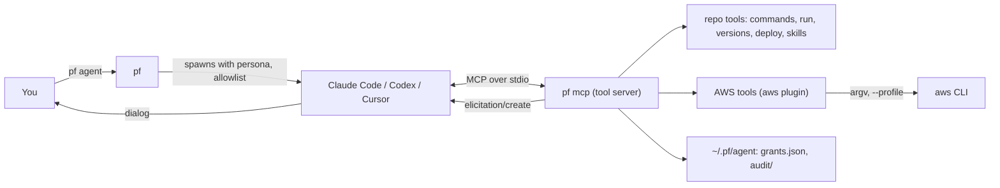

# pf agent

`pf agent` starts a coding agent CLI (Claude Code, Codex or Cursor) that works through pulpfixer. The agent gets this repo's resolved commands, versioning, staging deploys and skills as tools. For AWS troubleshooting it can ask for **scoped, read-only, time-limited access**, and pf asks you to approve each request. The agent never receives credentials: pf runs every AWS call itself and checks it against what you approved.

For a deployment that is misbehaving, [`pf t`](/agent/troubleshoot) (`pf troubleshoot`) starts the agent after pf has read how the repo deploys and linked its AWS profile, and adds fix actions you approve one call at a time.

The host fix agent (`pf host fix`, for EC2 instances) is a separate, headless mode. See [Host mode](/host).

## Quick start

```bash
# 1. Once per machine: a profile per project/account (nothing secret, only names)
pf profile add acme --aws-profile acme-readonly --account 123456789012 --region eu-west-1 --scopes identity,ec2,ecs,logs
pf profile check acme            # do the credentials resolve to the pinned account?

# 2. Once per repo: say which profile it uses (commit this)
echo '{ "profile": "acme" }' > pulpfixer.json        # or merge "profile" into your existing pulpfixer.json

# 3. Work with the agent
pf agent "the api service returns 502 since the last deploy, find out why"
```

The agent calls `pf_aws_profile`, then asks for access with a reason. A dialog opens in Claude Code:

```text
The agent asks pulpfixer for read-only AWS access.
Profile: acme (from pulpfixer.json), AWS profile acme-readonly, account 123456789012
Scopes: identity, ecs
Regions: eu-west-1
For: 20 minutes
Reason: api returns 502 after the last deploy
The agent never sees credentials. pf runs each call and refuses anything outside this grant.

[ ] Grant this access          (Read-only, 20 minutes, this session only)
```

If you tick the box and accept, the agent can read ECS service state for 20 minutes. If you decline, it is told not to ask again. `pf aws grants` (in another terminal) shows what is live, and `pf aws revoke --all` ends it immediately.

## How it fits together



- `pf agent` builds a system prompt (the *persona*) from the repo, writes the MCP config, and starts the agent CLI.
- The agent CLI starts `pf mcp` as a child process and talks to it over stdio (JSON-RPC, one message per line).
- `pf mcp` serves the built-in repo tools plus every plugin's tools. The AWS tools come from the built-in `aws` plugin.
- When a tool needs your approval, `pf mcp` sends an **elicitation** request back to the agent CLI, which shows it as a dialog and returns your answer.

## Starting the agent

```bash
pf agent                                   # interactive session in this repo
pf agent "fix the failing test"            # start with a task
pf agent --agent codex                     # claude | codex | cursor (also PF_AGENT, or "agent" in ~/.pf/config.json)
pf agent --profile side "check the alb"    # use another profile for this session
pf agent use claude                        # save the default agent CLI
pf agent --dry-run                         # print the persona and the command, start nothing
```

`pf a` is short for `pf agent`, and `pf t` starts [troubleshooting](/agent/troubleshoot). The first time several agent CLIs are installed, pf asks which one to use and remembers it. `pf agent use cursor` also registers the pf MCP server in `~/.cursor/mcp.json`.

What pf passes to each CLI:

| CLI | Persona | MCP server | Runs unasked |
|-----|---------|------------|--------------|
| Claude Code | `--append-system-prompt` | `--mcp-config ~/.pf/agent/mcp.json`, server started with `--require-elicitation` | read-only tools and tools that ask you themselves (`--allowedTools`) |
| Codex | placed before the prompt | `-c mcp_servers.pulpfixer.*` | per Codex's own settings |
| Cursor (`cursor-agent`) | placed before the prompt | `~/.cursor/mcp.json` (pf offers to register it; `pf agent use cursor` does it) | per Cursor's own settings |

`pf agent --profile acme --dry-run` with Claude shows the allowlist:

```text
would run claude --mcp-config ~/.pf/agent/mcp.json
  --allowedTools mcp__pulpfixer__pf_commands
  --allowedTools mcp__pulpfixer__pf_versions
  --allowedTools mcp__pulpfixer__pf_skills
  --allowedTools mcp__pulpfixer__pf_skill
  --allowedTools mcp__pulpfixer__pf_aws_profile
  --allowedTools mcp__pulpfixer__pf_aws_request_access
  --allowedTools mcp__pulpfixer__pf_aws_whoami
  --allowedTools mcp__pulpfixer__pf_aws_describe
  --allowedTools mcp__pulpfixer__pf_aws_context
  --allowedTools mcp__pulpfixer__pf_aws_link_profile
  --allowedTools mcp__pulpfixer__pf_aws_act
  --append-system-prompt '...'
  'the task'
```

Claude's `--allowedTools` and `--mcp-config` take every following argument, so the task comes after `--append-system-prompt` (one value). A task placed after the last `--allowedTools` is read as a tool name and the session opens with no prompt.

`pf_run`, `pf_bump` and `pf_deploy_staging` are not on the list, so Claude asks you before each call.

## The tools

| Tool | What it does | Read-only | Approval |
|------|--------------|-----------|----------|
| `pf_commands` | Stacks, the resolved dev/build/test/lint/install commands, pulpfixer.json commands, docs, staging, versioning and the pf link (`linked`, or what `pf rp` would refresh) | yes | none |
| `pf_run` | Run `build`, `test`, `lint` or `install` and return the exit code and the end of the output | no | the agent CLI's prompt |
| `pf_versions` | List module and stack versions (`versions.json`) | yes | none |
| `pf_bump` | Bump a module's minor or major version | no | the agent CLI's prompt |
| `pf_deploy_staging` | Return the staging plan; with `confirm: true`, run it | no | the agent CLI's prompt |
| `pf_skills`, `pf_skill` | List skills and read one | yes | none |
| `pf_aws_profile` | The profile, pinned account, limits, live grant and allowed operations | yes | none |
| `pf_aws_request_access` | Ask for a grant: scopes, regions, minutes, reason | no | **pf's dialog** |
| `pf_aws_whoami` | `sts get-caller-identity`, checked against the pinned account | yes | needs a grant |
| `pf_aws_describe` | One read-only AWS CLI call the grant allows | yes | needs a grant |
| `pf_aws_context` | How the repo deploys (read from its files), the profile that applies, scopes to request, enabled fix actions. Local only | yes | none |
| `pf_aws_link_profile` | Link a profile pf supports to this repo when none applies | no | **pf's dialog** |
| `pf_aws_act` | One AWS fix action the profile enables, shown as the exact command | no | **pf's dialog, every call** |

Plugins can add their own tools. See [Writing a plugin](/plugins/writing-a-plugin).

Prompts that use them:

```bash
pf agent "run the tests and fix what fails"                       # pf_commands, pf_run test, edits, pf_run test, pf_bump
pf agent "ship this to staging"                                   # pf_deploy_staging (plan), you agree, confirm: true
pf agent "why are tasks in the web cluster restarting?"           # pf_aws_profile, pf_aws_request_access ecs, pf_aws_describe
pf agent "is i-0abc123 healthy behind the alb? check eu-west-1"   # elb + ec2 scopes
pf agent "find errors in /ecs/api logs from the last hour"        # logs scope (only if the profile allows it)
```

A staging deploy returns the plan until the call passes `confirm`, and the agent CLI asks before running it. Production is never targeted, and neither is a repo's bare `deploy` (the `deploy` entry in `pulpfixer.json`): only you run `pf deploy`.

The agent also sets up deploys for repos that deploy through their own helper script (`./tl d`, `./al d`). `pf rp` asks which `pulpfixer.json` key to write, then starts the agent with the bundled `deploy-setup` skill (`packages/pulpfixer/assets/skills/deploy-setup/SKILL.md`) in print mode, so Claude exits when the file is written and pf previews `pf d`. pf streams the run as it goes: what the agent says, each tool it calls and anything that fails. The agent reads the repo's deploy notes and helper, prefers the dev-machine command over a server-only one, and writes the entry (with `"message": true` when the command commits). It never runs the deploy. See [Tools and repo setup](/commands/tools-and-repo).
