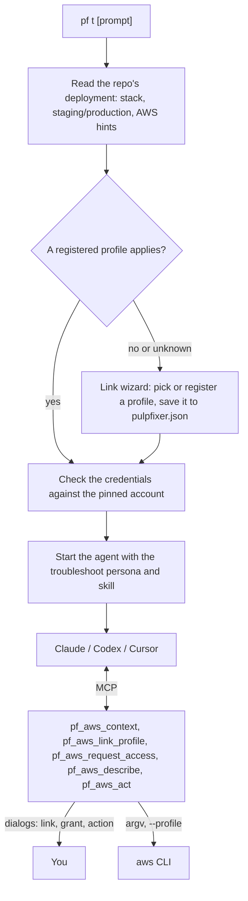

# pf troubleshoot

`pf troubleshoot` (`pf t`) is agent mode with a head start for production-style problems: **what is wrong with this deployment on AWS?** Before the agent starts, pf works out how the repo deploys and which AWS profile it uses. From then on pf is the agent's bridge to AWS: it asks you to approve reads and fixes, runs every call itself, and the agent never sees credentials.

```bash
pf t                                         # start; the agent asks what is wrong
pf t "the api returns 502 since the last deploy"
pf t --link                                  # only pick or change the AWS profile this repo uses
pf t --agent codex --profile side            # another agent CLI or profile for this session
pf t --dry-run                               # print what pf found, the check and the persona; start nothing
```

`pf t` needs a repo. Use [`pf agent`](/agent) anywhere else.

## What pf does first



1. **Detect.** pf reads the repo's own files, locally: CI workflows, CDK, SAM, Serverless and SST config, Terraform, ECS task definitions, deploy scripts. It collects the staging and production deploy commands (production only when the repo defines one), AWS account ids, regions, ECS clusters and services, Lambda functions, CloudFormation stacks and log groups, and which AWS services are in use. These are hints, not facts. No secrets are looked for, and nothing is called on AWS.
2. **Resolve the profile.** The first of `--profile`, `PF_PROFILE`, the repo's `pulpfixer.json`, the default profile (see [Profiles](/agent/profiles)). Only a profile in pf's registry (`profiles` in `~/.pf/config.json`) is supported: an AWS profile that pf does not list is never used.
3. **Link, if none applies.** The wizard lists the registered profiles and the AWS profiles in `~/.aws/config` that match what the repo mentions (a matching account id ranks first). You pick one, pf registers it if it is new (asking for the account to pin and the scopes to allow, with the scopes the repo's services need pre-filled), and writes `"profile": "<name>"` to this repo's `pulpfixer.json` after you confirm. Without a terminal, pf prints the best matches and the exact commands instead.
4. **Check the credentials.** `sts get-caller-identity` through the profile, against the pinned account. An expired SSO session offers `aws sso login --profile <name>`. A different account stops the session before the agent starts.
5. **Start the agent** with the deployment summary in its persona and the `troubleshoot` skill to follow.

```text
$ pf t
Deployment (read from this repo's files)
  stack: Node (npm)
  staging deploy: npm run deploy:staging (package.json script deploy:staging)
  AWS accounts in the repo: 123456789012
  regions in the repo: eu-west-1
  AWS services in use: ecs
  ECS clusters: web
  ECS services: api
  suggested scopes: identity, ecs, elb, cloudwatch, logs
profile acme (from pulpfixer.json) AWS profile acme-readonly, account 123456789012, region eu-west-1
✓ acme: credentials resolve to the pinned account 123456789012
```

## The bridge

The agent works only through pf tools. It never gets credentials and never runs the `aws` CLI.

| Tool | What it does | Approval |
|------|--------------|----------|
| `pf_aws_context` | The deployment summary, the profile that applies, the scopes to request and the fix actions enabled. Local only | none |
| `pf_aws_link_profile` | When no profile applies: a dialog lists the matching profiles, and you pick one and approve linking it | **pf's dialog** |
| `pf_aws_request_access` | A read grant: scopes, regions, minutes, reason. See [AWS access](/agent/aws-access) | **pf's dialog** |
| `pf_aws_whoami`, `pf_aws_describe` | Read-only calls inside the grant | needs a grant |
| `pf_aws_act` | One fix action, such as `ecs update-service --force-new-deployment` | **pf's dialog, for every call** |

### Link dialog

```text
The agent needs an AWS profile for this repo, and none is linked yet.
Repo: /Users/me/code/acme-api
The repo mentions: accounts 123456789012; regions eu-west-1
Reason: api returns 502

Profiles:
- acme (registered): AWS profile acme-readonly, account 123456789012, region eu-west-1. Matches: account 123456789012 appears in the repo
- corp-ro (new, from ~/.aws/config): AWS profile corp-ro, account 123456789012, region eu-west-1. Matches: account 123456789012 appears in the repo

Linking writes "profile" to pulpfixer.json in this repo. A new profile is registered in ~/.pf/config.json with the account pinned when known. Read access still needs its own approval.

Profile for this repo   [ acme (registered) v ]
[ ] Link this profile to the repo
```

If you decline, the agent is told not to ask again. The link applies to the running session at once.

### Fix actions

A read grant never changes anything. A fix is separate and stricter:

- **Off by default.** An action works only when your user profile lists it: `pf profile add acme --actions "ecs update-service,ecs stop-task"`. A repo's `pulpfixer.json` (`agent.aws.actions`) can only remove actions, never add one.
- **One call, one approval.** Every `pf_aws_act` call opens its own dialog with the exact command. Nothing runs without your answer there, and an earlier approval does not carry over. If the agent CLI cannot show the dialog, the action is refused, even in Codex or Cursor.
- **Only listed flags and values.** Each action accepts a fixed set of flags with checked values.
- **Pinned account and region.** The profile must pin an account, pf verifies it before it asks you, and the region must be within the profile's limits.
- **Traceable.** `aws-action-request`, `aws-action-decision`, `aws-action` and `aws-action-refused` events go to the session audit log. Output is redacted.

| Action | What it does | Accepted flags |
|--------|--------------|----------------|
| `ecs update-service` | redeploy, rescale or point a service at another task definition | `cluster`, `service`, `force-new-deployment`, `desired-count`, `task-definition` (at least one of the last three) |
| `ecs stop-task` | stop one task; its service starts a replacement | `cluster`, `task`, `reason` |
| `ec2 reboot-instances` | reboot instances | `instance-ids` |
| `autoscaling set-desired-capacity` | change an auto scaling group's size | `auto-scaling-group-name`, `desired-capacity` |
| `rds reboot-db-instance` | reboot a database instance, without failover | `db-instance-identifier` |

Deleting, terminating and anything with IAM or secrets is never an action.

```text
The agent asks pulpfixer to CHANGE something on AWS.
Profile: acme (from pulpfixer.json), AWS profile acme-readonly, account 123456789012 (verified)
Action: redeploy (force-new-deployment), rescale or point an ECS service at another task definition
Command: aws ecs update-service --cluster web --service api --force-new-deployment --output json --profile acme-readonly --region eu-west-1
Reason: tasks keep failing health checks on image api:1.42, the previous revision was healthy
This runs once, only if you approve it now. The agent never sees credentials.

[ ] Run this command          (This one call only)
```

Defense in depth still applies: point the profile at a role that allows only the actions you enabled.

## The skill

The agent follows the bundled `troubleshoot` skill (`packages/core/assets/skills/troubleshoot/SKILL.md`; a same-named skill of yours or in the repo wins): get oriented with `pf_aws_context`, request the fewest scopes, check the account, read from the symptom outward, compare with the last deploy, report the cause with evidence, then propose a fix and wait for your agreement before `pf_aws_act`.

## Without `pf t`

The same tools are served by `pf agent` and `pf mcp`, so any session can use them. `pf t` adds the detection, the link wizard, the credentials check, the persona and the skill.

## Where things live

| Path | What |
|------|------|
| `packages/core/src/commands/troubleshoot.ts` | the command, the link wizard, the credentials check |
| `packages/plugin-aws/src/infra.ts` | deployment detection (`detectAwsDeployment`, `scanAwsHints`, `scopesFor`) |
| `packages/plugin-aws/src/awsconfig.ts` | `~/.aws/config` parsing (names, account, region, kind only) and candidate ranking |
| `packages/plugin-aws/src/link.ts` | `linkChoices`, `applyLink`: register a profile and name it in `pulpfixer.json` |
| `packages/plugin-aws/src/access.ts` | `ACTIONS`, `checkAction`, the new `lambda-metadata` and `cloudformation` scopes |
| `packages/plugin-aws/src/agent-tools.ts` | `pf_aws_context`, `pf_aws_link_profile`, `pf_aws_act` |
| `packages/kit/src/profiles.ts`, `context.ts` | `linkRepoProfile`, `refreshContext` (config reloads before each tool call) |
| `packages/core/assets/skills/troubleshoot/` | the skill |
