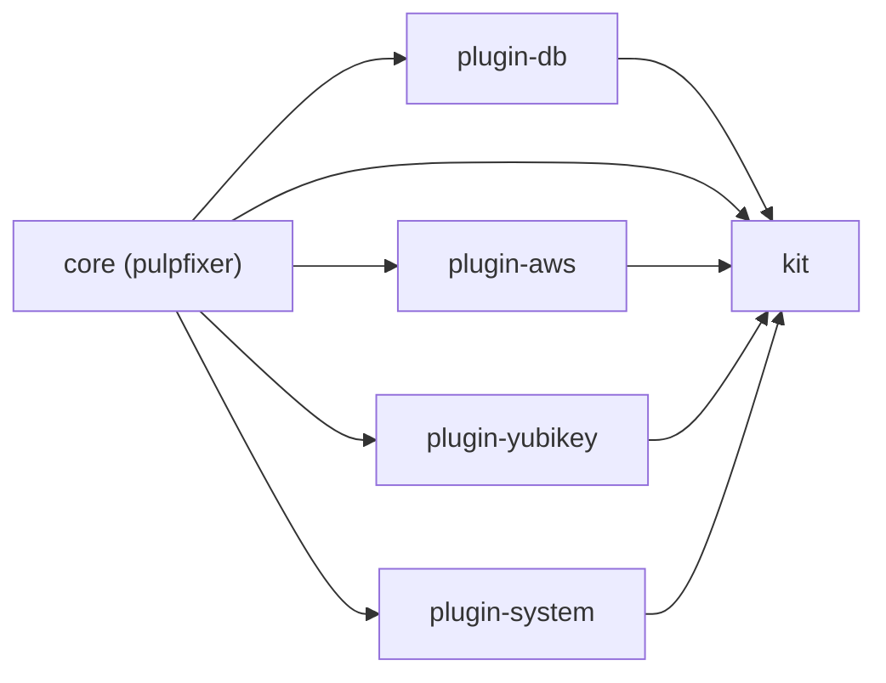

# Developing pf

pf is a pnpm workspace. The shipped packages are versioned together by `versions.json` and published to the cellars registry (`https://cellars.staging.pangenea.com/`).

| Package | Name | What |
|---------|------|------|
| `packages/kit` | `@pulpfixer/kit` | Shared foundation: detect, exec, ui, config, util, context and the `Command` / `Plugin` types. Depends on nothing |
| `packages/plugin-aws` | `@pulpfixer/plugin-aws` | The AWS plugin. Depends only on kit |
| `packages/plugin-db` | `@pulpfixer/plugin-db` | The database plugin (`pf db`, the `sql` and `Db` helpers, `defineQueries`). Depends only on kit |
| `packages/db-postgres`, `db-mysql` | `@pulpfixer/db-<name>` | Database drivers: registry plugins with a `dbDrivers` list. Neither has an npm runtime dependency: each is a hand-written protocol client (PostgreSQL; MySQL / MariaDB) on Node's `net`, `tls` and `crypto`. Published alone, not a dependency of core. SQLite needs no npm package (`node:sqlite`), so it is built into `plugin-db` (`src/drivers/sqlite.ts`) |
| `packages/plugin-system` | `@pulpfixer/plugin-system` | The system plugin (`pf sys`). Depends only on kit |
| `packages/plugin-yubikey` | `@pulpfixer/plugin-yubikey` | The YubiKey plugin. Depends only on kit |
| `packages/preset-cursor` | `@pulpfixer/preset-cursor` | Data only: the standard Cursor extensions and settings. Published alone, not a dependency of core: `pf sys apply cursor` fetches its latest version |
| `packages/preset-suite` | `@pulpfixer/preset-suite` | Data only: the pulpfixer suite, a list of extension packages. Published alone: `pf sys apply suite` fetches its latest version |
| `packages/ext-bg-tone` | `@pulpfixer/ext-bg-tone` | The Background Tone extension for Cursor, shipped as a `.vsix`. Published alone, never a dependency of core: `pf sys apply suite` and `pf update` fetch its latest version. Type-checked on its own (it targets the VS Code API) |
| `packages/pulpfixer` | `pulpfixer` | The `pf` binary: built-in commands, agent, host mode, skills, install and update. Depends on kit and every plugin |
| `packages/docs` | `@pulpfixer/docs` | This documentation site (Nextra). Private, never published |



Dependencies point one way: core to plugins to kit. A plugin never imports core. Anything a plugin needs from core moves into kit.

Each package exports `source`, `types` and `default` conditions. Dev, tests and typecheck run with `--conditions=source` (straight from `src/`), while builds and installs use `dist/`.

## Commands

`pnpm ask` lists every script.

```bash
pnpm install
pnpm dev -- list          # run from source
pnpm typecheck && pnpm test && pnpm build
pnpm install:local        # build and link this checkout as the global pf
pnpm docs:dev             # this site, on http://localhost:4400 (same as pf docs)
pnpm docs:build           # build the site and its search index
```

`./pf` in the checkout root runs the local source with no build, while the global `pf` stays as installed. It keeps your current directory, so you can point it at another repo:

```bash
./pf dev --dry-run
cd ~/some/repo && ~/dev/agents/pulpfixer/pf dev --dry-run
```

## Layout

| Path | What |
|------|------|
| `packages/pulpfixer/src/bin/pf.ts`, `cli.ts` | Entry point, banner, dispatch |
| `packages/pulpfixer/src/menu.ts` | Repo menu, fallback menu, static list |
| `packages/pulpfixer/src/commands/` | Built-in commands |
| `packages/pulpfixer/src/agent/` | Coding agent: persona, tool registry, MCP server, launchers |
| `packages/pulpfixer/src/host/` | Host mode |
| `packages/pulpfixer/src/skills/` | Skill discovery and runner |
| `packages/pulpfixer/src/plugins/` | Plugin registry, loader and management |
| `packages/pulpfixer/src/install/`, `update/` | Machine setup and update check |
| `packages/kit/src/detect/` | Repo, stack, docs and staging detection, command resolution |
| `packages/kit/src/ui/` | Palette, picker, prompts, text helpers |
| `packages/plugin-aws/src/`, `plugin-system/src/`, `plugin-yubikey/src/` | The built-in plugins |
| `packages/preset-cursor/preset.json` | The Cursor standard that `pf sys apply cursor` applies |
| `packages/preset-suite/preset.json`, `packages/ext-bg-tone/` | The suite (`pf sys apply suite`) and the Background Tone extension it installs |
| `packages/docs/content/` | This site's pages |
| `scripts/` | Cross-package commands: build, test, release, ver, logo, ask |

## Adding things

**A command.** Add `packages/pulpfixer/src/commands/<name>.ts`, register it in `packages/pulpfixer/src/commands/index.ts`, show it in `packages/pulpfixer/src/menu.ts` if it belongs in the menu, and add a test. A shortcut is one entry in `SHORTCUTS` ([Shortcuts](/commands/shortcuts)).

**A stack.** Add it to `packages/kit/src/detect/stacks.ts` with a test in `packages/kit/tests/`.

**A built-in plugin.** Create `packages/plugin-<name>` (copy `plugin-aws`'s `package.json` and `tsconfig`), add it to `scripts/build.mjs`, to `ORDER` in `scripts/release.mjs`, to the `core` dependencies and to `packages/pulpfixer/src/plugins/index.ts`, then run `pnpm ver init`.

**A registry plugin.** See [Writing a plugin](/plugins/writing-a-plugin). Registry plugins live in the npm prefix `~/.pf/plugins`, and core imports them at startup in `main()`. Failures never stop pf.

## Docs

Pages live in `packages/docs/content/` as MDX, with a `_meta.ts` per folder that sets the sidebar order and titles. When you change a command, plugin or the agent, update the matching page. The agent guide also exists in `packages/pulpfixer/docs/agent.md`, so keep the two in step.

### Hosting on AWS Amplify

The site is hosted as a static export. `amplify.yml` at the repo root builds it with `pnpm run build:static` (`DOCS_EXPORT=1 next build`, then the Pagefind index into `out/_pagefind`) and serves `packages/docs/out`. In the Amplify console, connect the repo, tick "My app is a monorepo" and set the app root to `packages/docs`. Without `DOCS_EXPORT`, `pf docs` and `pnpm docs:build` behave as before (a Next server).
