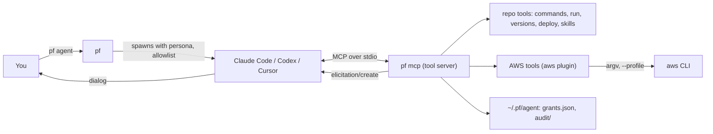
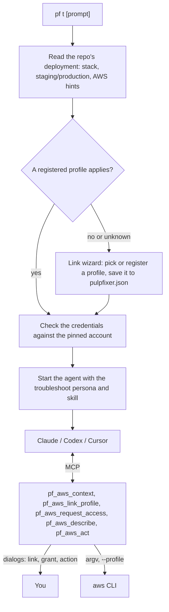
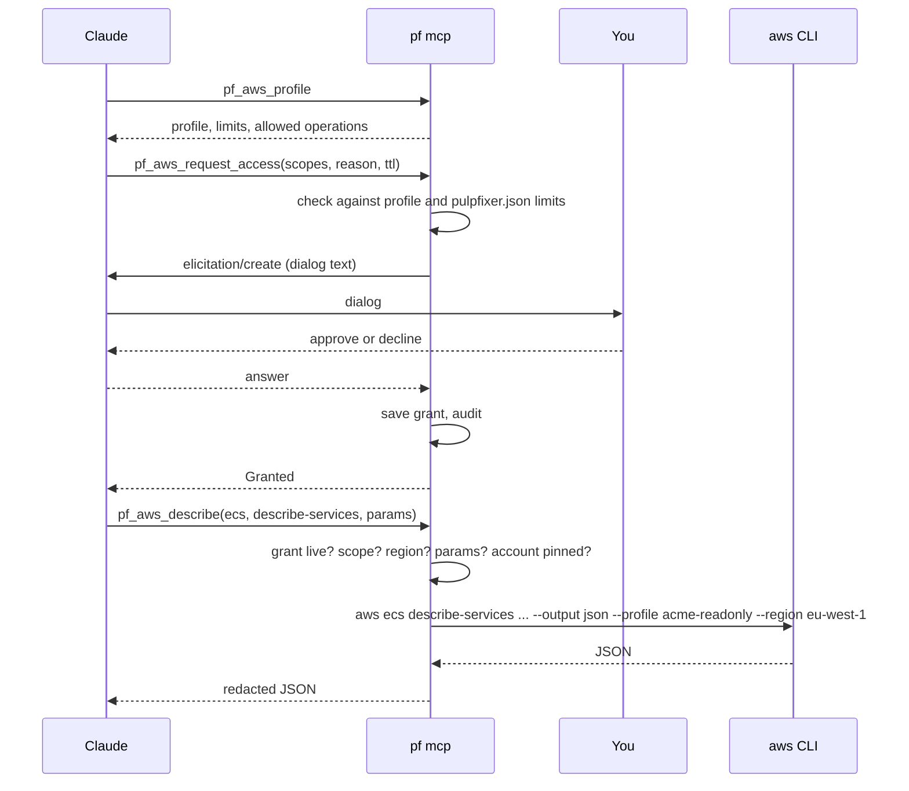

# pf agent: tools, profiles and scoped AWS access

`pf agent` starts a coding agent CLI (Claude Code, Codex or Cursor) that works through pulpfixer. The agent gets this repo's resolved commands, versioning, staging deploys and skills as tools. For AWS troubleshooting it can ask for **scoped, read-only, time-limited access**, and pf asks you to approve each request. `pf t` (`pf troubleshoot`) adds the repo's deployment detection, a wizard that links its AWS profile, and fix actions you approve one call at a time. The agent never receives credentials: pf runs every AWS call itself and checks it against what you approved.

This guide covers how to use these features and how they are built:

1. [Quick start](#quick-start)
2. [How it fits together](#how-it-fits-together)
3. [Starting the agent](#starting-the-agent)
4. [The tools](#the-tools)
5. [Troubleshoot mode (`pf t`)](#troubleshoot-mode-pf-t)
6. [Profiles](#profiles)
7. [AWS access for the agent](#aws-access-for-the-agent)
8. [Using the pf tools from other MCP clients](#using-the-pf-tools-from-other-mcp-clients)
9. [Implementation](#implementation)
10. [Writing agent tools in a plugin](#writing-agent-tools-in-a-plugin)
11. [Security model](#security-model)
12. [Troubleshooting](#troubleshooting)

The host fix agent (`pf host fix`, for EC2 instances) is a separate, headless mode. It is described in the [README](../README.md#the-fix-agent).

## Quick start

```bash
# 1. Once per machine: a profile per project/account (nothing secret, only names)
pf profile add acme --aws-profile acme-readonly --account 123456789012 --region eu-west-1 --scopes identity,ec2,ecs,logs
pf profile check acme            # do the credentials resolve to the pinned account?

# 2. Once per repo: say which profile it uses (commit this)
echo '{ "profile": "acme" }' > pulpfixer.json        # or merge "profile" into your existing pulpfixer.json

# 3. Work with the agent
pf agent "the api service returns 502 since the last deploy, find out why"
```

The agent calls `pf_aws_profile`, then asks for access with a reason. A dialog opens in Claude Code:

```text
The agent asks pulpfixer for read-only AWS access.
Profile: acme (from pulpfixer.json), AWS profile acme-readonly, account 123456789012
Scopes: identity, ecs
Regions: eu-west-1
For: 20 minutes
Reason: api returns 502 after the last deploy
The agent never sees credentials. pf runs each call and refuses anything outside this grant.

[ ] Grant this access          (Read-only, 20 minutes, this session only)
```

If you tick the box and accept, the agent can read ECS service state for 20 minutes. If you decline, it is told not to ask again. `pf aws grants` (in another terminal) shows what is live, and `pf aws revoke --all` ends it immediately.

## How it fits together



- `pf agent` builds a system prompt (the *persona*) from the repo, writes the MCP config, and starts the agent CLI.
- The agent CLI starts `pf mcp` as a child process and talks to it over stdio (JSON-RPC, one message per line).
- `pf mcp` serves the built-in repo tools plus every plugin's tools. The AWS tools come from the built-in `aws` plugin.
- When a tool needs your approval, `pf mcp` sends an **elicitation** request back to the agent CLI, which shows it as a dialog and returns your answer.

## Starting the agent

```bash
pf agent                                   # interactive session in this repo
pf agent "fix the failing test"            # start with a task
pf agent --agent codex                     # claude | codex | cursor (also PF_AGENT, or "agent" in ~/.pf/config.json)
pf agent --profile side "check the alb"    # use another profile for this session
pf agent use claude                        # save the default agent CLI
pf agent --dry-run                         # print the persona and the command, start nothing
```

`pf a` is short for `pf agent`. The first time several agent CLIs are installed, pf asks which one to use and remembers it.

What pf passes to each CLI:

| CLI | Persona | MCP server | Runs unasked |
|-----|---------|------------|--------------|
| Claude Code | `--append-system-prompt` | `--mcp-config ~/.pf/agent/mcp.json`, server started with `--require-elicitation` | read-only tools and tools that ask you themselves (`--allowedTools`) |
| Codex | placed before the prompt | `-c mcp_servers.pulpfixer.*` | per Codex's own settings |
| Cursor (`cursor-agent`) | placed before the prompt | `~/.cursor/mcp.json` (pf offers to register it; `pf agent use cursor` does it) | per Cursor's own settings |

`pf agent --profile acme --dry-run` with Claude shows the allowlist:

```text
would run claude --mcp-config ~/.pf/agent/mcp.json
  --allowedTools mcp__pulpfixer__pf_commands
  --allowedTools mcp__pulpfixer__pf_versions
  --allowedTools mcp__pulpfixer__pf_skills
  --allowedTools mcp__pulpfixer__pf_skill
  --allowedTools mcp__pulpfixer__pf_aws_profile
  --allowedTools mcp__pulpfixer__pf_aws_request_access
  --allowedTools mcp__pulpfixer__pf_aws_whoami
  --allowedTools mcp__pulpfixer__pf_aws_describe
  --allowedTools mcp__pulpfixer__pf_aws_context
  --allowedTools mcp__pulpfixer__pf_aws_link_profile
  --allowedTools mcp__pulpfixer__pf_aws_act
  --append-system-prompt '...'
  'the task'
```

Claude's `--allowedTools` and `--mcp-config` take every following argument, so the task comes after `--append-system-prompt` (one value). A task placed after the last `--allowedTools` is read as a tool name and the session opens with no prompt.

`pf_run`, `pf_bump` and `pf_deploy_staging` are not on the list, so Claude asks you before each call.

## The tools

| Tool | What it does | Read-only | Approval |
|------|--------------|-----------|----------|
| `pf_commands` | Stacks, the resolved dev/build/test/lint/install commands, pulpfixer.json commands, docs, staging, versioning and the pf link (`linked`, or what `pf rp` would refresh) | yes | none |
| `pf_run` | Run `build`, `test`, `lint` or `install` and return the exit code and the end of the output | no | the agent CLI's prompt |
| `pf_versions` | List module and stack versions (`versions.json`) | yes | none |
| `pf_bump` | Bump a module's minor or major version | no | the agent CLI's prompt |
| `pf_deploy_staging` | Return the staging plan; with `confirm: true`, run it | no | the agent CLI's prompt |
| `pf_skills`, `pf_skill` | List skills and read one | yes | none |
| `pf_aws_profile` | The profile, pinned account, limits, live grant and allowed operations | yes | none |
| `pf_aws_request_access` | Ask for a grant: scopes, regions, minutes, reason | no | **pf's dialog** |
| `pf_aws_whoami` | `sts get-caller-identity`, checked against the pinned account | yes | needs a grant |
| `pf_aws_describe` | One read-only AWS CLI call the grant allows | yes | needs a grant |
| `pf_aws_context` | How the repo deploys (read from its files), the profile that applies, scopes to request, enabled fix actions. Local only | yes | none |
| `pf_aws_link_profile` | Link a profile pf supports to this repo when none applies | no | **pf's dialog** |
| `pf_aws_act` | One AWS fix action the profile enables, shown as the exact command | no | **pf's dialog, every call** |

Prompts that use them:

```bash
pf agent "run the tests and fix what fails"                       # pf_commands, pf_run test, edits, pf_run test, pf_bump
pf agent "ship this to staging"                                   # pf_deploy_staging (plan), you agree, confirm: true
pf agent "why are tasks in the web cluster restarting?"           # pf_aws_profile, pf_aws_request_access ecs, pf_aws_describe
pf agent "is i-0abc123 healthy behind the alb? check eu-west-1"   # elb + ec2 scopes
pf agent "find errors in /ecs/api logs from the last hour"        # logs scope (only if the profile allows it)
```

`pf_deploy_staging` is the only deploy tool. Production and a repo's bare `deploy` (the `deploy` entry in `pulpfixer.json`, run with `pf deploy` / `pf d`) are never targeted: only the user runs them.

### Deploy setup (`pf rp --deploy`)

For a repo that deploys through its own helper script (`./tl d`, `./al d`) `pf repo` asks which `pulpfixer.json` key to write (`deploy`, `deploy:staging` or `deploy:production`; no terminal means `deploy`), then starts the agent with the bundled `deploy-setup` skill (`packages/pulpfixer/assets/skills/deploy-setup/SKILL.md`). Claude and Cursor are started in print mode, so the process exits when the task is done and pf continues. Print mode writes stream-json events (`--output-format stream-json`, plus `--verbose` for Claude), and pf shows them live (`packages/pulpfixer/src/agent/stream.ts`): the agent's messages, each tool call with its main argument, failed tools, and a closing line with the time, turns and cost. If the repo still has a legacy `pf.json`, `pf repo` renames it to `pulpfixer.json` before the agent starts. The prompt lists the helpers pf found at the repo root, ranked (`GWLOCAL` helpers first, server-only ones such as `a.sh` last) as hints only. The agent reads the repo's deploy notes and the helper, picks the dev-machine command, and writes that key, with `"message": true` when the command commits and takes a commit message. It never runs the deploy. pf then previews `pf d`.

## Troubleshoot mode (`pf t`)

`pf troubleshoot` (`pf t`) is agent mode with a head start for production-style problems: **what is wrong with this deployment on AWS?** Before the agent starts, pf works out how the repo deploys and which AWS profile it uses. From then on pf is the agent's bridge to AWS: it asks you to approve reads and fixes, runs every call itself, and the agent never sees credentials.

```bash
pf t                                         # start; the agent asks what is wrong
pf t "the api returns 502 since the last deploy"
pf t --link                                  # only pick or change the AWS profile this repo uses
pf t --agent codex --profile side            # another agent CLI or profile for this session
pf t --dry-run                               # print what pf found, the check and the persona; start nothing
```

`pf t` needs a repo. Use [`pf agent`](#starting-the-agent) anywhere else.

### What pf does first



1. **Detect.** pf reads the repo's own files, locally: CI workflows, CDK, SAM, Serverless and SST config, Terraform, ECS task definitions, deploy scripts. It collects the staging and production deploy commands (production only when the repo defines one), AWS account ids, regions, ECS clusters and services, Lambda functions, CloudFormation stacks and log groups, and which AWS services are in use. These are hints, not facts. No secrets are looked for, and nothing is called on AWS.
2. **Resolve the profile.** The first of `--profile`, `PF_PROFILE`, the repo's `pulpfixer.json`, the default profile (see [Profiles](#profiles)). Only a profile in pf's registry (`profiles` in `~/.pf/config.json`) is supported: an AWS profile that pf does not list is never used.
3. **Link, if none applies.** The wizard lists the registered profiles and the AWS profiles in `~/.aws/config` that match what the repo mentions (a matching account id ranks first). You pick one, pf registers it if it is new (asking for the account to pin and the scopes to allow, with the scopes the repo's services need pre-filled), and writes `"profile": "<name>"` to this repo's `pulpfixer.json` after you confirm. Without a terminal, pf prints the best matches and the exact commands instead.
4. **Check the credentials.** `sts get-caller-identity` through the profile, against the pinned account. An expired SSO session offers `aws sso login --profile <name>`. A different account stops the session before the agent starts.
5. **Start the agent** with the deployment summary in its persona and the `troubleshoot` skill to follow.

```text
$ pf t
Deployment (read from this repo's files)
  stack: Node (npm)
  staging deploy: npm run deploy:staging (package.json script deploy:staging)
  AWS accounts in the repo: 123456789012
  regions in the repo: eu-west-1
  AWS services in use: ecs
  ECS clusters: web
  ECS services: api
  suggested scopes: identity, ecs, elb, cloudwatch, logs
profile acme (from pulpfixer.json) AWS profile acme-readonly, account 123456789012, region eu-west-1
✓ acme: credentials resolve to the pinned account 123456789012
```

### The bridge

The agent works only through pf tools. It never gets credentials and never runs the `aws` CLI.

| Tool | What it does | Approval |
|------|--------------|----------|
| `pf_aws_context` | The deployment summary, the profile that applies, the scopes to request and the fix actions enabled. Local only | none |
| `pf_aws_link_profile` | When no profile applies: a dialog lists the matching profiles, and you pick one and approve linking it | **pf's dialog** |
| `pf_aws_request_access` | A read grant: scopes, regions, minutes, reason. See [AWS access](#aws-access-for-the-agent) | **pf's dialog** |
| `pf_aws_whoami`, `pf_aws_describe` | Read-only calls inside the grant | needs a grant |
| `pf_aws_act` | One fix action, such as `ecs update-service --force-new-deployment` | **pf's dialog, for every call** |

#### Link dialog

```text
The agent needs an AWS profile for this repo, and none is linked yet.
Repo: /Users/me/code/acme-api
The repo mentions: accounts 123456789012; regions eu-west-1
Reason: api returns 502

Profiles:
- acme (registered): AWS profile acme-readonly, account 123456789012, region eu-west-1. Matches: account 123456789012 appears in the repo
- corp-ro (new, from ~/.aws/config): AWS profile corp-ro, account 123456789012, region eu-west-1. Matches: account 123456789012 appears in the repo

Linking writes "profile" to pulpfixer.json in this repo. A new profile is registered in ~/.pf/config.json with the account pinned when known. Read access still needs its own approval.

Profile for this repo   [ acme (registered) v ]
[ ] Link this profile to the repo
```

If you decline, the agent is told not to ask again. The link applies to the running session at once.

#### Fix actions

A read grant never changes anything. A fix is separate and stricter:

- **Off by default.** An action works only when your user profile lists it: `pf profile add acme --actions "ecs update-service,ecs stop-task"`. A repo's `pulpfixer.json` (`agent.aws.actions`) can only remove actions, never add one.
- **One call, one approval.** Every `pf_aws_act` call opens its own dialog with the exact command. Nothing runs without your answer there, and an earlier approval does not carry over. If the agent CLI cannot show the dialog, the action is refused, even in Codex or Cursor.
- **Only listed flags and values.** Each action accepts a fixed set of flags with checked values.
- **Pinned account and region.** The profile must pin an account, pf verifies it before it asks you, and the region must be within the profile's limits.
- **Traceable.** `aws-action-request`, `aws-action-decision`, `aws-action` and `aws-action-refused` events go to the session audit log. Output is redacted.

| Action | What it does | Accepted flags |
|--------|--------------|----------------|
| `ecs update-service` | redeploy, rescale or point a service at another task definition | `cluster`, `service`, `force-new-deployment`, `desired-count`, `task-definition` (at least one of the last three) |
| `ecs stop-task` | stop one task; its service starts a replacement | `cluster`, `task`, `reason` |
| `ec2 reboot-instances` | reboot instances | `instance-ids` |
| `autoscaling set-desired-capacity` | change an auto scaling group's size | `auto-scaling-group-name`, `desired-capacity` |
| `rds reboot-db-instance` | reboot a database instance, without failover | `db-instance-identifier` |

Deleting, terminating and anything with IAM or secrets is never an action.

```text
The agent asks pulpfixer to CHANGE something on AWS.
Profile: acme (from pulpfixer.json), AWS profile acme-readonly, account 123456789012 (verified)
Action: redeploy (force-new-deployment), rescale or point an ECS service at another task definition
Command: aws ecs update-service --cluster web --service api --force-new-deployment --output json --profile acme-readonly --region eu-west-1
Reason: tasks keep failing health checks on image api:1.42, the previous revision was healthy
This runs once, only if you approve it now. The agent never sees credentials.

[ ] Run this command          (This one call only)
```

Defense in depth still applies: point the profile at a role that allows only the actions you enabled.

### The skill

The agent follows the bundled `troubleshoot` skill (`packages/pulpfixer/assets/skills/troubleshoot/SKILL.md`; a same-named skill of yours or in the repo wins): get oriented with `pf_aws_context`, request the fewest scopes, check the account, read from the symptom outward, compare with the last deploy, report the cause with evidence, then propose a fix and wait for your agreement before `pf_aws_act`.

### Without `pf t`

The same tools are served by `pf agent` and `pf mcp`, so any session can use them. `pf t` adds the detection, the link wizard, the credentials check, the persona and the skill.

### Where things live (troubleshoot)

| Path | What |
|------|------|
| `packages/pulpfixer/src/commands/troubleshoot.ts` | the command, the link wizard, the credentials check |
| `packages/plugin-aws/src/infra.ts` | deployment detection (`detectAwsDeployment`, `scanAwsHints`, `scopesFor`) |
| `packages/plugin-aws/src/awsconfig.ts` | `~/.aws/config` parsing (names, account, region, kind only) and candidate ranking |
| `packages/plugin-aws/src/link.ts` | `linkChoices`, `applyLink`: register a profile and name it in `pulpfixer.json` |
| `packages/plugin-aws/src/access.ts` | `ACTIONS`, `checkAction`, the new `lambda-metadata` and `cloudformation` scopes |
| `packages/plugin-aws/src/agent-tools.ts` | `pf_aws_context`, `pf_aws_link_profile`, `pf_aws_act` |
| `packages/kit/src/profiles.ts`, `context.ts` | `linkRepoProfile`, `refreshContext` (config reloads before each tool call) |
| `packages/pulpfixer/assets/skills/troubleshoot/` | the skill |

## Profiles

A profile ties a project to an AWS account and limits what the agent may be granted there. There are two layers:

| Layer | File | Holds | Trusted to |
|-------|------|-------|------------|
| User | `~/.pf/config.json` | AWS profile name, pinned account, region, agent limits | widen and narrow |
| Repo | `pulpfixer.json` (committed) | which profile the repo uses, optional tighter limits | narrow only |

A cloned repo is not trusted, so its `pulpfixer.json` can never allow more than your user profile does.

### User profiles

```bash
pf profile add acme --aws-profile acme-readonly --account 123456789012 --region eu-west-1 --scopes identity,ec2,ecs,logs
pf profile add side --aws-profile sp-ro --region us-east-1      # no --scopes: everything except logs
pf profile add acme --max-ttl 30                                 # edit one field; others are kept
pf profile add acme --region ""                                  # clear a field
pf profile add acme --actions "ecs update-service,ecs stop-task" # let the agent ask for these fixes (each call is approved by you)
pf profile add acme --actions ""                                 # none again
pf profile add                                                   # in a terminal: a wizard
```

The resulting `~/.pf/config.json`:

```json
{
  "profiles": {
    "acme": {
      "aws": { "profile": "acme-readonly", "account": "123456789012", "region": "eu-west-1" },
      "agent": { "aws": { "scopes": ["identity", "ec2", "ecs", "logs"], "maxTtlMinutes": 30 } }
    },
    "side": {
      "aws": { "profile": "sp-ro", "region": "us-east-1" }
    }
  },
  "defaultProfile": "acme"
}
```

| Field | Meaning | Default |
|-------|---------|---------|
| `aws.profile` | profile name in `~/.aws/config` (required) | none |
| `aws.account` | 12-digit account the credentials must resolve to | not pinned (pf warns) |
| `aws.region` | region for calls | from the AWS profile |
| `agent.aws.scopes` | scopes the agent may be granted | all except `logs` |
| `agent.aws.regions` | regions the agent may read | `aws.region`, else any |
| `agent.aws.maxTtlMinutes` | longest grant | 60 (hard cap 480) |
| `agent.aws.actions` | fix actions the agent may ask for, each approved one call at a time | none |

Pin the account. pf then runs `sts get-caller-identity` before the first read of every grant, and refuses everything if the credentials point somewhere else (a stale SSO session, a mixed-up profile).

### Repo profile

```json
{
  "name": "acme-api",
  "profile": "acme",
  "agent": { "aws": { "scopes": ["identity", "ecs", "logs"], "regions": ["eu-west-1"], "maxTtlMinutes": 20 } },
  "commands": {}
}
```

`agent.aws` is optional. Each list (scopes, regions, actions) is intersected with the user's limits, and the shorter time wins. A repo can remove an action the user enabled, never add one.

`pf t` writes the `"profile"` line for you: when no profile applies it lists the registered profiles and the AWS profiles in `~/.aws/config` that match the repo, and links the one you pick.

### Which profile applies

The first of:

1. `pf agent --profile <name>`, or the name given to `pf profile show <name>` / `pf profile check <name>`
2. `PF_PROFILE`
3. `"profile"` in the repo's `pulpfixer.json`
4. `"defaultProfile"` (`pf profile use <name>`)

### Commands

```bash
pf profile                 # list (also in the pf menu)
pf profile show [name]     # the effective profile here, after pulpfixer.json narrowing
pf profile use <name>      # make it the default
pf profile check [name]    # sts get-caller-identity vs the pinned account (--dry-run prints the command)
pf profile remove <name>
```

```text
$ pf profile
┌────────────────┬───────────────┬──────────────┬───────────┬─────────────────────────────────────────────────────────────────────┐
│ profile        │ aws profile   │ account      │ region    │ agent scopes                                                        │
├────────────────┼───────────────┼──────────────┼───────────┼─────────────────────────────────────────────────────────────────────┤
│ acme (default) │ acme-readonly │ 123456789012 │ eu-west-1 │ identity, ec2, ecs, logs                                            │
│ side           │ sp-ro         │ not pinned   │ us-east-1 │ identity, ec2, ecs, rds, elb, cloudwatch, ssm-metadata, s3-metadata │
└────────────────┴───────────────┴──────────────┴───────────┴─────────────────────────────────────────────────────────────────────┘
here: acme (from default)

$ pf profile show side
  profile       side (from flag)
  aws profile   sp-ro
  account       not pinned
  region        us-east-1
  agent limits  scopes identity, ec2, ecs, rds, elb, cloudwatch, ssm-metadata, s3-metadata; regions us-east-1; at most 60 min
```

### Example: several projects, one machine

```bash
pf profile add acme    --aws-profile acme-readonly  --account 111111111111 --region eu-west-1 --scopes identity,ecs,logs
pf profile add acme-dw --aws-profile acme-data-ro   --account 222222222222 --region eu-central-1 --scopes identity,rds,cloudwatch
pf profile add side    --aws-profile sp-ro          --account 333333333333 --region us-east-1
```

```text
~/code/acme-api/pulpfixer.json        { "profile": "acme" }
~/code/acme-warehouse/pulpfixer.json  { "profile": "acme-dw" }
~/code/side-project/pulpfixer.json    { "profile": "side", "agent": { "aws": { "scopes": ["identity", "ec2"] } } }
```

Each repo's agent sessions then use their own account and limits, with no switching. `pf agent --profile acme-dw` overrides one session.

## AWS access for the agent

### The flow



### What the agent sees

`pf_aws_profile` (abridged):

```text
pf profile: acme (from pulpfixer.json)
AWS profile: acme-readonly
account: 123456789012 (pinned)
region: eu-west-1
limits: scopes identity, ec2, ecs, logs; regions eu-west-1; at most 60 min
grant: none. Call pf_aws_request_access with the scopes you need and why.

Operations by scope (pf_aws_describe accepts only these):
- identity (who the credentials are (always part of a grant)): sts: get-caller-identity
- ecs (clusters, services, tasks, task definitions (environment values redacted)): ecs: list-clusters, describe-clusters, ...
...
You never get credentials: pf runs each call itself and checks it against the grant. Secret-looking values are redacted.
```

A request (the arguments Claude sends):

```json
{ "scopes": ["ecs"], "reason": "api returns 502 after the last deploy", "ttlMinutes": 20 }
```

After you approve:

```text
Granted. active grant: scopes identity, ecs; regions eu-west-1; 20 min left; approved by the user in pf's dialog
Use pf_aws_whoami to confirm the account, then pf_aws_describe.
```

A read. Params are AWS CLI flags without the dashes: a list becomes several values, `true` a bare flag, `false` is left out.

```json
{
  "service": "ecs",
  "operation": "describe-services",
  "params": { "cluster": "web", "services": ["api"], "query": "services[].{name:serviceName,running:runningCount,desired:desiredCount,events:events[:5]}" }
}
```

pf runs:

```bash
aws ecs describe-services --cluster web --services api --query '...' --output json --profile acme-readonly --region eu-west-1
```

What gets refused, and the message the agent gets:

| Call | Answer |
|------|--------|
| `secretsmanager get-secret-value` | `aws secretsmanager get-secret-value is never allowed: it returns secret values.` |
| `logs filter-log-events` without the scope | `... needs the "logs" scope, which this grant does not include. Request it with pf_aws_request_access.` |
| `ec2 terminate-instances` | `... is not a read-only operation pf allows. Call pf_aws_profile for the list.` |
| `params: { "cluster": "file:///etc/passwd" }` | `--cluster: values that load a file or URL are not allowed` |
| `params: { "profile": "prod" }` | `--profile is set by pf or not allowed` |
| a region outside the grant | `Region us-east-1 is outside the grant (eu-west-1).` |
| `scopes: ["rds"]` beyond the profile | `The profile "acme" does not allow rds (allowed: identity, ec2, ecs, logs). Only the user can widen that, ...` (you are not asked) |
| any call before a grant | `No live AWS grant for profile "acme". Call pf_aws_request_access ...` |
| credentials resolve to another account | `This is not the pinned account 123456789012. pf refuses to read anything with these credentials; ...` |

### Scopes

| Scope | Services and operations |
|-------|-------------------------|
| `identity` | `sts get-caller-identity` (part of every grant) |
| `ec2` | `ec2 describe-instances`, `describe-instance-status`, `describe-security-groups`, `describe-security-group-rules`, `describe-subnets`, `describe-vpcs`, `describe-volumes`, `describe-snapshots`, `describe-images`, `describe-network-interfaces`, `describe-route-tables`, `describe-addresses`, `describe-availability-zones`, `describe-regions`, `describe-nat-gateways`, `describe-internet-gateways`, `describe-tags`, `describe-launch-templates`; `autoscaling describe-auto-scaling-groups`, `describe-scaling-activities`, `describe-auto-scaling-instances` |
| `ecs` | `list-clusters`, `describe-clusters`, `list-services`, `describe-services`, `list-tasks`, `describe-tasks`, `list-container-instances`, `describe-container-instances`, `list-task-definitions`, `describe-task-definition` (environment values redacted) |
| `rds` | `describe-db-instances`, `describe-db-clusters`, `describe-db-snapshots`, `describe-events`, `describe-pending-maintenance-actions`, `describe-db-subnet-groups`, `describe-db-log-files` |
| `elb` | `elbv2 describe-load-balancers`, `describe-listeners`, `describe-rules`, `describe-target-groups`, `describe-target-health`, `describe-load-balancer-attributes`, `describe-target-group-attributes`; `elb describe-load-balancers`, `describe-instance-health` |
| `cloudwatch` | `describe-alarms`, `describe-alarm-history`, `list-metrics`, `get-metric-statistics`, `get-metric-data` |
| `logs` | `describe-log-groups`, `describe-log-streams`, `describe-metric-filters`, `filter-log-events`, `get-log-events` (opt-in: log text can hold secrets) |
| `ssm-metadata` | `describe-instance-information`, `describe-instance-patch-states`, `describe-parameters` (names, never values), `list-commands` |
| `lambda-metadata` | `lambda list-functions`, `get-function-configuration`, `list-aliases`, `list-versions-by-function`, `list-event-source-mappings`, `get-event-source-mapping`, `get-function-concurrency` (environment values redacted, never code) |
| `cloudformation` | `cloudformation list-stacks`, `describe-stacks`, `describe-stack-events`, `describe-stack-resources`, `describe-stack-resource`, `list-stack-resources` (never templates) |
| `s3-metadata` | `s3api list-buckets`, `get-bucket-location`, `get-bucket-versioning`, `get-bucket-encryption`, `get-public-access-block`, `get-bucket-policy-status`, `get-bucket-lifecycle-configuration`, `list-objects-v2`, `head-object` (never object contents) |

Never allowed, with any grant: secret values (`secretsmanager get-secret-value`, `ssm get-parameter(s)`, `get-parameters-by-path`), command output (`ssm get-command-invocation`), shells (`ssm start-session`), file contents (`s3api get-object`, `s3 cp`, `s3 sync`), decryption (`kms decrypt`), code links and invocation (`lambda get-function`, `lambda invoke`), templates (`cloudformation get-template`), passwords and user data (`ec2 get-password-data`, `describe-instance-attribute`, `describe-launch-template-versions`, `autoscaling describe-launch-configurations`), credentials (`ecr get-login-password`, `sts get-session-token`, `assume-role`, `get-federation-token`, `iam create-access-key`), and `rds download-db-log-file-portion`. Anything not listed in a scope is refused as well.

Flags pf sets itself or refuses: `--profile`, `--region`, `--output`, `--endpoint-url`, `--cli-input-json`, `--cli-input-yaml`, `--generate-cli-skeleton`, `--debug`, `--ca-bundle`, `--no-verify-ssl`, `--no-sign-request`, `--cli-binary-format`, `--with-decryption`, `--color`, `--no-paginate`, `--page-size`. Values may not load a file or URL (`file://`, `fileb://`, `http(s)://`) or start with `--`.

### Redaction

pf parses the JSON and hides:

- every `value` in a container `environment` list (ECS task definitions), keeping the names, and every value in a Lambda `Environment.Variables` map;
- any string field whose key looks secret (`password`, `secret`, `token`, `credential`, `privateKey`, `apiKey`, `UserData`), except `nextToken`, which paging needs;
- the `Value` of a name/value pair whose name looks secret (`{ "Name": "db_password", "Value": "..." }`).

Then pf masks secret-looking text anywhere, which matters most for logs: access key ids (`AKIA...`, `ASIA...`), private key blocks, JWTs, `Bearer` tokens, and `password=`, `secret:`, `token=`, `api_key=`, `aws_secret_access_key=` pairs. Output over 30,000 characters is cut, with a hint to narrow the call with `--query`, `--filters` or `--max-items`.

```json
{
 "containerDefinitions": [
  { "name": "api", "image": "acme/api:1.42", "environment": [
    { "name": "DB_HOST", "value": "[redacted by pf]" },
    { "name": "API_KEY", "value": "[redacted by pf]" } ] }
 ]
}
```

Redaction is a safety net, not a guarantee. Keep the `logs` scope off profiles whose logs carry secrets.

### Grants

A grant is stored in `~/.pf/agent/grants.json`. It holds names and limits only, never credentials. It belongs to one agent session (one `pf mcp` process), and ends at the first of:

- its time running out;
- the session ending (pf drops grants whose server process is gone);
- `pf aws revoke`. The server re-reads the file on every call, so a revoke applies to the next call.

```text
$ pf aws grants
┌──────────┬─────────┬───────────────┬───────────┬────────┬─────────────┬───────────────────────────────────────┐
│ session  │ profile │ scopes        │ regions   │ left   │ approved in │ reason                                │
├──────────┼─────────┼───────────────┼───────────┼────────┼─────────────┼───────────────────────────────────────┤
│ 6f1c9a2e │ acme    │ identity, ecs │ eu-west-1 │ 23 min │ pf dialog   │ api returns 502 after the last deploy │
└──────────┴─────────┴───────────────┴───────────┴────────┴─────────────┴───────────────────────────────────────┘
End one with pf aws revoke <session> or all with pf aws revoke --all

$ pf aws revoke 6f1c9a2e --dry-run
would revoke 6f1c9a2e (acme: identity, ecs)

$ pf aws revoke --profile acme
✓ revoked 1 grant; the agent's next AWS call is refused
```

### Audit log

Each agent session writes one log to `~/.pf/agent/audit/<time>-<session>.log` (owner-only): a header, then one JSON line per event. Tool arguments are logged, AWS responses are not.

```text
{"id":"053c1b29","startedAt":"2026-11-05T22:42:39.505Z","kind":"agent","cwd":"/Users/me/code/acme-api","user":"me","pf":"4.38.0"}
{"at":"...","event":"aws-request","profile":"acme","scopes":["identity","ecs"],"regions":["eu-west-1"],"ttlMinutes":20,"reason":"api returns 502 after the last deploy"}
{"at":"...","event":"aws-decision","profile":"acme","approved":true,"action":"accept"}
{"at":"...","event":"tool","tool":"pf_aws_request_access","args":{"scopes":["ecs"],"reason":"...","ttlMinutes":20},"ok":true}
{"at":"...","event":"aws-call","service":"ecs","operation":"describe-services","region":"eu-west-1","ok":true}
{"at":"...","event":"aws-refused","service":"secretsmanager","operation":"get-secret-value","reason":"..."}
```

Other events: `aws-account-mismatch` (expected and actual account), `tool` for every tool call, `aws-link-request`, `aws-link-decision` and `aws-link` for profile linking, and `aws-action-request`, `aws-action-decision`, `aws-action` and `aws-action-refused` for fix actions.

### When the agent CLI cannot show a dialog

| Situation | What happens |
|-----------|--------------|
| Claude Code, interactive (`pf agent`) | pf's dialog |
| Claude Code, `claude -p` (no UI) | Claude cancels the dialog, so nothing is granted |
| Claude Code without elicitation support | refused: the server runs with `--require-elicitation` because the tool is on Claude's allowlist |
| Codex or Cursor with elicitation | pf's dialog |
| Codex or Cursor without it | the CLI's own tool prompt counts as the approval (`approved in: agent prompt`) |

## Using the pf tools from other MCP clients

`pf mcp` is a plain stdio MCP server, so any MCP client can use it:

```bash
pf mcp [--cwd <repo>] [--profile <name>] [--require-elicitation]
```

| Flag | Meaning |
|------|---------|
| `--cwd` | the repo the tools work in (placeholders like `${workspaceFolder}` that were not expanded are ignored) |
| `--profile` | the pf profile for this server (the same as `PF_PROFILE`) |
| `--require-elicitation` | refuse approvals the client cannot show as a dialog. Set it whenever the client runs `pf_aws_request_access` without asking |

Project `.mcp.json` for Claude Code, or `~/.cursor/mcp.json`:

```json
{
  "mcpServers": {
    "pulpfixer": { "command": "pf", "args": ["mcp", "--cwd", "/Users/me/code/acme-api", "--require-elicitation"] }
  }
}
```

Headless Claude Code, with only pf's AWS tools (useful in scripts; approvals are cancelled without a UI, so grant-needing reads fail):

```bash
claude -p "Call pf_aws_profile and summarize the limits." \
  --mcp-config ./pf-mcp.json --strict-mcp-config --tools "" \
  --allowedTools mcp__pulpfixer__pf_aws_profile
```

The elicitation exchange on the wire. Requests from pf have ids like `pf-1`:

```json
→ {"jsonrpc":"2.0","id":1,"method":"initialize","params":{"protocolVersion":"2025-06-18","capabilities":{"elicitation":{}}}}
← {"jsonrpc":"2.0","id":1,"result":{"protocolVersion":"2025-06-18","capabilities":{"tools":{},"prompts":{}},"serverInfo":{"name":"pulpfixer","version":"4.38.0"},"instructions":"..."}}
→ {"jsonrpc":"2.0","id":2,"method":"tools/call","params":{"name":"pf_aws_request_access","arguments":{"scopes":["ec2"],"reason":"disk full on web-1"}}}
← {"jsonrpc":"2.0","id":"pf-1","method":"elicitation/create","params":{"message":"The agent asks pulpfixer for read-only AWS access.\n...","requestedSchema":{"type":"object","properties":{"approve":{"type":"boolean","title":"Grant this access","default":false}},"required":["approve"]}}}
→ {"jsonrpc":"2.0","id":"pf-1","result":{"action":"accept","content":{"approve":true}}}
← {"jsonrpc":"2.0","id":2,"result":{"content":[{"type":"text","text":"Granted. ..."}],"isError":false}}
```

pf accepts form elicitation as `elicitation: {}` (2025-06-18) or `elicitation: { "form": {} }` (later revisions). A client that offers only `url` mode counts as unable to show the dialog.

## Implementation

### Where things live

| Path | What |
|------|------|
| `packages/kit/src/agent-tool.ts` | `Tool`, `ToolResult`, `ToolSession`, `ElicitResult`, `objectSchema()` |
| `packages/kit/src/plugin.ts` | `Plugin.tools(ctx)`: plugins contribute tools |
| `packages/kit/src/config.ts` | `ProfileConfig`, `AgentAwsScope`, parsing of `profiles` and pulpfixer.json `profile` / `agent.aws` |
| `packages/kit/src/profiles.ts` | `resolveProfile`, `narrowLimits`, `saveProfile`, `removeProfile`, `setDefaultProfile` |
| `packages/pulpfixer/src/agent/launch.ts` | `startAgent`: picks the CLI, builds the persona, writes launch files, spawns |
| `packages/pulpfixer/src/agent/adapters.ts` | `buildLaunch` per CLI, `mcpServerArgv`, Claude's allowlist |
| `packages/pulpfixer/src/agent/persona.ts` | the system prompt and its rules |
| `packages/pulpfixer/src/agent/mcp.ts` | the MCP server: `handle`, `serve`, sessions, elicitation, audit |
| `packages/pulpfixer/src/agent/tools.ts` | the built-in repo tools (`TOOLS`) |
| `packages/pulpfixer/src/plugins/index.ts` | `agentTools(ctx)`: built-in tools, then plugin tools that do not reuse a name |
| `packages/pulpfixer/src/commands/mcp.ts`, `profile.ts`, `agent.ts` | `pf mcp`, `pf profile`, `pf agent` |
| `packages/pulpfixer/src/audit.ts` | `openAudit`, shared with host mode |
| `packages/plugin-aws/src/access.ts` | scopes, `DENIED`, `checkOperation`, `limitsFor`, `paramArgv`, `redactJson`, `redactText` |
| `packages/plugin-aws/src/grants.ts` | the grant store |
| `packages/plugin-aws/src/project.ts` | `projectAws(ctx)`: the profile that applies, ready to use, or why not |
| `packages/plugin-aws/src/agent-tools.ts` | the `pf_aws_*` tools |
| `packages/plugin-aws/src/infra.ts`, `awsconfig.ts`, `link.ts` | `pf t`: deployment detection, `~/.aws/config` parsing and ranking, linking a repo to a profile |
| `packages/pulpfixer/src/commands/troubleshoot.ts` | `pf t`: the command, the link wizard, the credentials check |
| `packages/plugin-aws/src/commands/aws.ts` | `pf aws grants` / `pf aws revoke` |

### The tool contract

```ts
// @pulpfixer/kit/agent-tool
export interface Tool {
  name: string;                               // pf_<area>_<verb>; Claude shows mcp__pulpfixer__<name>
  description: string;                        // what the model reads to decide when to call it
  inputSchema: Record<string, unknown>;       // JSON Schema; objectSchema(props, required) refuses extra keys
  readOnly: boolean;                          // changes nothing: Claude may run it unasked
  asksUser?: boolean;                         // asks you itself through elicitation: Claude may run it unasked
  run(ctx: Context, input: Record<string, unknown>, session?: ToolSession): Promise<ToolResult>;
}

export interface ToolSession {
  id: string;                                 // this agent session (one pf mcp process)
  elicit?(message: string, requestedSchema: Record<string, unknown>): Promise<ElicitResult>;  // missing when the client cannot show a dialog
  trustClientPrompt: boolean;                 // without elicit: may the CLI's own prompt stand in for your approval?
  audit(event: Record<string, unknown>): void;
}
```

A tool returns `{ ok, text }`. `ok: false` reaches the model as an MCP error result, and the text should say what to do next. A thrown error becomes `pf <tool> failed: <message>`.

### How the server serves a session

- `serve()` reads one JSON-RPC message per line. A message with a `method` goes to `handle()`. A message with only an `id` and a `result` or `error` answers one of pf's own requests (`pf-1`, `pf-2`, ...) and resolves the matching promise.
- `initialize` stores the client's capabilities on the session. `toolSession()` gives a tool `elicit` only when they include form elicitation.
- `tools/call` runs the tool with its `ToolSession` and logs `{ event: "tool", tool, args, ok }`. Tool calls run concurrently, so a tool waiting on your answer does not block others.
- The audit file opens lazily on the first event, and when stdin closes, pending requests are rejected.
- `requireElicitation` (`--require-elicitation`) sets `trustClientPrompt: false`.

### How Claude's allowlist is built

```ts
// packages/pulpfixer/src/agent/adapters.ts
function claudeAllowedTools(tools: Tool[]): string[] {
  return tools.filter((t) => t.readOnly || t.asksUser).map((t) => `mcp__${SERVER_NAME}__${t.name}`);
}
// buildLaunch for claude: mcpServerArgv(cwd, { profile, requireElicitation: true })
// argv order: --mcp-config, --allowedTools..., --append-system-prompt, then the task.
// The first two flags are variadic, so the task has to follow the single-value system prompt.
```

A tool may only be `asksUser` if it gets your approval from `session.elicit` before it changes anything. Because Claude runs those tools unasked, its server always starts with `--require-elicitation`.

### Adding an AWS operation or scope

Add one line to `SCOPES` in `packages/plugin-aws/src/access.ts`:

```ts
{
  name: 'ecs',
  summary: 'clusters, services, tasks, task definitions (environment values redacted)',
  ops: {
    ecs: [/* ... */, 'describe-capacity-providers'],     // a new read operation
  },
},
{
  name: 'sqs-metadata',                                  // a new scope
  summary: 'queues and their attributes (never messages)',
  ops: { sqs: ['list-queues', 'get-queue-attributes'] },
},
```

Before adding one, check what it returns. If it can include secrets, file contents, user data or credentials, add it to `DENIED` with a reason instead. A new scope is off for profiles that list their scopes until the user adds it. Profiles without `scopes` get every scope except `logs`, so change `DEFAULT_SCOPES` when a new scope should be opt-in. Add a case to `packages/plugin-aws/tests/access.test.ts`.

## Writing agent tools in a plugin

Any plugin can serve tools: the built-in ones, or `@pf-plugins/<name>` from the registry. This complete example adds a team-notes tool the agent can read freely, and an append that needs your approval:

```ts
// @pf-plugins/notes: src/index.ts
import fs from 'node:fs';
import path from 'node:path';
import { objectSchema, type Tool, type ToolResult } from '@pulpfixer/kit/agent-tool';
import type { Context } from '@pulpfixer/kit/context';
import type { Plugin } from '@pulpfixer/kit/plugin';

const fail = (text: string): ToolResult => ({ ok: false, text });
const notesFile = (ctx: Context) => path.join(ctx.repo?.root ?? ctx.workdir, 'NOTES.md');

const readNotes: Tool = {
  name: 'pf_notes_read',
  description: "Read this repo's NOTES.md (team notes: known issues, runbooks).",
  inputSchema: objectSchema(),
  readOnly: true,
  async run(ctx) {
    const file = notesFile(ctx);
    if (!fs.existsSync(file)) return fail('This repo has no NOTES.md.');
    return { ok: true, text: fs.readFileSync(file, 'utf8') };
  },
};

const appendNote: Tool = {
  name: 'pf_notes_append',
  description: 'Append a note to NOTES.md. pf shows the note to the user, and nothing is written unless they approve.',
  inputSchema: objectSchema({ text: { type: 'string', description: 'The note, in Markdown' } }, ['text']),
  readOnly: false,
  asksUser: true,
  async run(ctx, input, session) {
    const text = typeof input.text === 'string' ? input.text.trim() : '';
    if (!text) return fail('text is required');
    if (!session) return fail('pf can only ask the user inside an MCP session.');

    if (session.elicit) {
      const answer = await session.elicit(`The agent wants to add this note to NOTES.md:\n\n${text}`, {
        type: 'object',
        properties: { approve: { type: 'boolean', title: 'Add the note', default: false } },
        required: ['approve'],
      });
      const approved = answer.action === 'accept' && answer.content?.approve === true;
      session.audit({ event: 'notes-append', approved });
      if (!approved) return fail('The user did not approve the note.');
    } else if (!session.trustClientPrompt) {
      return fail('pf could not ask the user (this agent CLI shows no elicitation dialogs).');
    }

    fs.appendFileSync(notesFile(ctx), `\n${text}\n`);
    return { ok: true, text: 'Note added.' };
  },
};

const notesPlugin: Plugin = {
  name: 'notes',
  summary: 'Team notes for the agent',
  commands: [],
  tools: () => [readNotes, appendNote],
};
export default notesPlugin;
```

Rules for plugin tools:

- **Names:** prefix them `pf_<plugin>_`. A tool that reuses a built-in name is dropped, and the built-in wins.
- **Approval:** treat an approval as something only `session.elicit` gives you. Never let the model approve itself through an argument such as `confirm: true`. Check `approved` from the answer, not just `action === 'accept'`: the user can accept the form with the box unticked.
- **Without a dialog:** go ahead only if `session.trustClientPrompt` is true. Otherwise refuse with a message the model can pass on.
- **Logging:** call `session.audit()` for decisions and for anything that leaves the machine.
- **No shell:** never run a shell line built from model input. Build an argv array, and check every value (see `paramArgv`).
- **Secrets:** never return them. Redact output that can contain them.
- **`tools(ctx)`:** keep it cheap and side-effect free. It runs at every `pf mcp` start and every `pf agent` launch, and a throw only drops the plugin's tools.

A built-in plugin lists its tools the same way: `packages/plugin-aws/src/index.ts` has `tools: () => AWS_AGENT_TOOLS`.

### Testing a tool

Run the tool directly with a fake session. Here `appendNote` is the tool from the example above and `repoDir` is a temp directory with a `.git/HEAD`. The AWS tests put a fake `aws` script on `PATH` in the same way:

```ts
import assert from 'node:assert/strict';
import { test } from 'node:test';
import type { ElicitResult, ToolSession } from '@pulpfixer/kit/agent-tool';
import { buildContext } from '@pulpfixer/kit/context';

function session(answer: ElicitResult | null, trustClientPrompt = false): ToolSession {
  return {
    id: 'test',
    trustClientPrompt,
    ...(answer ? { elicit: async () => answer } : {}),
    audit: () => undefined,
  };
}

test('the note is written only after approval', async () => {
  const ctx = buildContext(repoDir);
  const declined = await appendNote.run(ctx, { text: 'x' }, session({ action: 'decline' }));
  assert.equal(declined.ok, false);
  const refused = await appendNote.run(ctx, { text: 'x' }, session(null));
  assert.match(refused.text, /could not ask the user/);
  const ok = await appendNote.run(ctx, { text: 'x' }, session({ action: 'accept', content: { approve: true } }));
  assert.equal(ok.ok, true);
});
```

To test over the protocol, drive `serve()` with in-memory streams: send `initialize` with `capabilities.elicitation`, call the tool, answer the `elicitation/create` request, and read the result. See `mcp serve: a grant request asks the user through elicitation and is audited` in `packages/pulpfixer/tests/agent.test.ts`. The AWS tool tests are in `packages/plugin-aws/tests/agent-tools.test.ts`.

## Security model

- **No credentials for the agent.** pf passes only `--profile <name>` to the aws CLI. The credentials stay with the AWS CLI and SSO, and pf never reads, prints or stores them.
- **Approval outside the model.** A grant needs your answer in a dialog. No tool argument can approve one.
- **Two layers of limits.** Your profile caps what can be asked for, and a repo can only narrow it. Inside a grant, every call is checked for operation, scope, region, parameters and account.
- **Fail closed.** No grant, no read. A wrong account means nothing is read. With no dialog and a client that runs the tool unasked, the grant is refused.
- **Fixes are separate and stricter.** `pf_aws_act` runs only actions your profile enables, with listed flags, on a pinned account, and only after you approve that exact command in pf's dialog. It never falls back to the agent CLI's own prompt.
- **Only registered profiles.** pf uses an AWS profile only when it is in pf's registry (`~/.pf/config.json`). Linking one to a repo needs your pick and approval.
- **Short-lived.** Grants last minutes, end with the session, and can be revoked from another terminal.
- **Traceable.** Every request, decision, call and refusal is logged per session in `~/.pf/agent/audit/`.
- **Defense in depth.** Point each profile at a read-only IAM role (`ViewOnlyAccess`, or tighter), so AWS refuses writes even if pf had a bug.

Limits to keep in mind:

- Read-only metadata can still be sensitive: resource names, IPs, tags, and log lines with the `logs` scope.
- Redaction catches common patterns only.
- A repo's `pulpfixer.json` chooses which of your profiles applies. The dialog always names the profile, its source, and the account, so read it before approving.

## Troubleshooting

| Symptom | Cause and fix |
|---------|---------------|
| `No pf profile applies here` | Add one (`pf profile add`) and name it in `pulpfixer.json`, or set a default with `pf profile use` |
| `The profile "x" ... is not configured` | `pulpfixer.json` names a profile this machine does not have: `pf profile add x ...` |
| `has no AWS profile` | `pf profile add x --aws-profile <name>` |
| The dialog never shows; the grant says `could not ask the user` | the agent CLI lacks MCP elicitation, or this is `claude -p`. Update the CLI, or run the agent interactively |
| `aws ... is not enabled for this profile` | the action is off for this profile: `pf profile add <name> --actions "<service> <operation>"`, or run the change yourself |
| `Fix actions need a pinned account` | `pf profile add <name> --account <id>` |
| `No AWS profiles are available` (link dialog) | pf has no profiles and `~/.aws/config` lists none: `aws configure sso`, then `pf t --link` |
| `This is not the pinned account` | the AWS profile resolves to another account, often after an SSO login to another account. Check with `pf profile check`, fix `~/.aws/config` or log in again |
| `aws ... failed: ... ExpiredToken` / `SSO session expired` | `aws sso login --profile <aws-profile>` |
| `aws CLI not found on PATH` | install the aws CLI v2 |
| Output cut | narrow the call with `query`, `filters`, `max-items` or a shorter time range |
| The agent keeps the old profile | the server re-reads `~/.pf/config.json` and `pulpfixer.json` before each tool call, so an edit applies on the next call. `--profile` and `PF_PROFILE` still win over `pulpfixer.json` for that session |
| Check what the agent did | `ls -t ~/.pf/agent/audit/ \| head -1`, then read that log |
